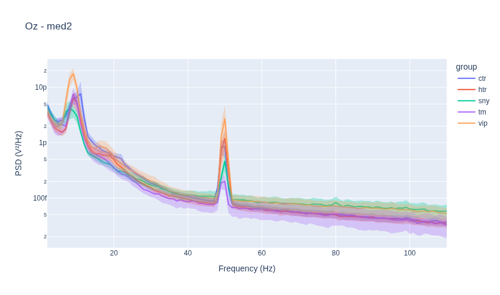
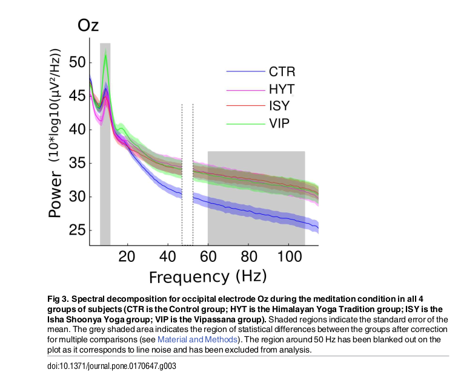
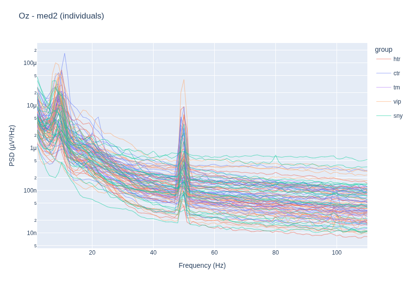
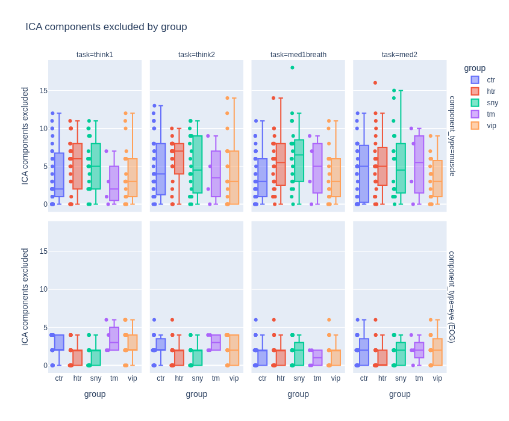
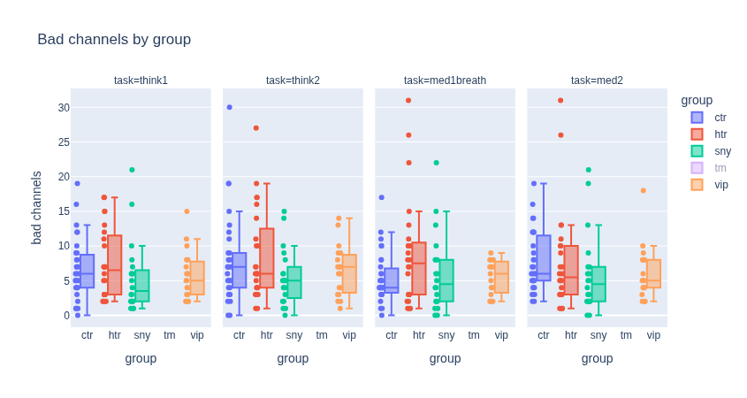

# EEG Replication Project

Aim: build a simple EEG processing pipeline then replicate some basic results from a paper (https://pmc.ncbi.nlm.nih.gov/articles/PMC5261734/)

Data is at: https://openneuro.org/datasets/ds003969/versions/1.0.0

##  Steps

1. Install relevant packages 
2. Explore data in a notebook 
3. Get familiar with analysis tools like MNE-python, MNE-BIDS
4. Produce some standardised analysis and explore data formats
5. Implement independently some analytical functions to produce desired outputs
6. Compare results to package implementations for similarity

## Curiosities for later exploration

* Authors use right mastoid as reference, why not left, do these give similar results?

* Authors don't seem clear on what hypotheses they tested? it's probably worth thinking about how many hypotheses they likely tested to end up with their final results and adjusting things accordingly.

* Authors make some conclusions regarding frequency bands including 100Hz but they don't do much to deal with 50Hz line noise. They exclude this 50Hz band but they don't account for harmonics. Is this an issue? Manual inspections doesn't show much going on at 100Hz that is abnormal.

## Replication summary

* Referenced to right mastoid (EXG6)
* Subsampled to 256Hz
* Bandpass filtered with same filter
* Implented the `pop_rejcont` function in python, manual  inspection of it's flagging seems sensible
* The next step involved manual inspection then rerunning `pop_rejcont` with lower tolerance over certain series. Given they don't specify how they chose these I can't replicate it and shall hope it's unimportant.


### 30/9/26

I've manage to figure out how to load data in this standardised format using `mne-bids`, then had a play around with analysing it using `mne`.

The data is quite simple to use but I'm running into some annoying OOM issues as well as having too slow internet.

Next steps are to get more familiar with `mne` and what it can do, then try to step-by-step replicate the authors' pipeline. Initially let's try do this exactly whilst commenting on anything that seems off, we can revisit robustness to those later.

A useful note on the electrodes from the data website:

```Hello, Here are the details of the positions of the external electrodes:
Ext1 --> left eye corner
Ext 2 --> right eye corner
Ext 3 --> left eye eyebrow (above)
Ext 4 --> left eye below
Ext 7 --> middle of the collar bone
Ext 5 --> left mastoide
Ext 6 --> right mastoide
EXT 8 was set up with an extra electrode for Fp1, due to a defect of that electrode on the Biosemi electrode set.
So from that you have: 
 Ext1 and Ext2: HEOG; 
 Ext3 and Ext 4: VEOG (blinks); 
Ext 7: ECG
Ext5: M1
Ext6: M2
Ext8: FP1

Hope it helps!
```

Right mastoid is used for reference by authors. Setting this removes most of the obvious line artifacts.

Implementing pop_rejcont in python involved getting very much into the weeds. Lots of details left out of the paper and needed to be guessed at from the matlab defaults, claude handled implementation and wrote tests.

Have made it up to manual bad channel inspection, I have a plan for this tomorrow.

### 1/10/26

Day two and I'll start properly later but a nice side quest has presented itself.

I want ideally a pipeline I fully understand and trust, that I can point at new data sources and be happy with with little manual work. Hence, I want to automate my bad channel detection. So plan is to build a simple bad channel detection widget, run this, then still do the full manual detection to confirm it's working after. I had the idea in my mind to look for some sauna EEG data and it would be nice to just run and verify rather than implement fresh each time. Given all this it's worth pulling all this out into my own convenience package in the future.

I've added a simple minimum variance threshold in the automated pipeline now, things are running well.

Next steps:

* Make notebook for going through manual annotation
* Come up with a format for storing processed data and record of bad channels
* Figure out what's going on with referencing interacting badly with `pop_rejcont` and filtering


Everything looks fine with referencing, it's doing the simple subtraction transform one expects.

Looking more closeltt at the data it's clear that referencing messes up the broken channels, with the broken channels just becoming the inverse of the reference channel, then looking like normal data later on once processed. We definitely need to identify bad channels by processing but not referencing then inspecting.

Still need to play around with this more.

### 2/10/26

Planned pipeline:

* Preprocess without referencing to identify bad channels
* Save bad channels
* Do preprocessing with referencing
* Then, infomax ICA on processed data
* Save processsed data
 
for the ICA part they reference this paper https://pubmed.ncbi.nlm.nih.gov/17188898/

It seems they use an automated implementation in Matlab. MNE/python also has this functionality and I'll try to use something similar.

I also stumbled upon the `autoreject` package for bad channel/epoch detection, worth looking at this in more detail for the future rather than redoing the janky stuff in this paper.

I figured out why Fp1 is bad: it isn't used and EXG8 is used instead, just need to swap the data in there. This makes things look more sane. pop_rejcont seems to be working as intendd.

OK so new plan now that referencing and other problems resolved:

* Do preprocessing
* Suggest bad channels, visually inspect to confirm
* Do ICA
* Save all processed data 

For now I have the bad channel suggestion automated using the built in `mne` function based on waveform distance, but also I built my own that takes that approach but applies it to spectral distance over 1-45Hz. These seem complementary and so far the suggestions seem good. I'll run through a bunch before the final run through to calibrate the thresholf I want to use here.

Now I need to look into ICA. The authors are not overly specific so it sound like they use a vanilla package version. I shall do similarly, using the python version but making the settings close where possible.

It seems there is quite an art to detecting ICA components. https://labeling.ucsd.edu/tutorial/labels is a very good resource for this. I'm not quite confident yet to go through each manually and call out which they are. Luckily MNE has automatic detection functions in place for muscle and EOG artefacts which seem to behave sensibly on some test cases. I'm going to just use these.

### 3/10/26

Yesterday I implemented the ICA stuff. As in the work we're replicating, we'll try to exclude muscle and eye artifacts from the data. There are automated functions for this in MNE, and I've used those. Looking at the outputs of those in a notebook and comparing to the resource above all the suggestions seem sensible.

The full data processing loop is now ready to go. I'm going to run it with the manual bad channel labelling for now, see how much my selections agree with the automated suggestions. If they line up nicely then I'll just run the whole thing automatically, perhaps changing the thresholding slightly on the automated functions to line them up better.

OK I'm going to run this automated and then compare results/see how many channels are marked bad, as decisions seem good so far. 

TODO: compare decisions with my simple criteria here to RANSAC

Have looked at using autoreject and it does seem to be making sensible decisions, but it deviates too much from the original paper so I will make a note to use it in the future but not for this initial replication attempt.

Everything has run now and I'm processing the data to take a quick look at how close we get to replicating the headline result from previously.

### 4/10/26

Below is the first pass at replicating the power spectra by group. We see the vipassana group having higher alpha band power, and this is common across conditions as in the paper, looking like a fairly robust result. 

However, the gamma band trait difference observed by the authors between the control group and the rest is not observed at all. This is famously difficult this region due to muscle and eye artifacts. Given how the authors identify the ICA components for these things very manually, it's quite hard to tell why my results differ so dramatically.

dsa

dsa





Next steps are to investigate this alpha discrepancy. The effects is so marked in the chart above but is not present at all in my data.

It is likely due to a difference in processing pipelines, and most likely how muscle ICA components are removed. I'll revisit that and see how decisions were made for each group.

First I've looked at individual traces all on the same plot grouped by type. There are no clear outliers here



This is at least guidance that whatever the difference is, it is likely systematic rather than outlier handling.

Another questions I need to get on top of is translatin my graphs to the same weird y scale they use: I want to know where the power differences are more severe in the spectrum.

At least my values agree with normal values across studies, so I'm not wrong I just need to get the conversion right.

There values are not plausible so there is a factor that is off here. It looks like it's from squaring the FFT but not normalising. Normalisation factor is maybe 48dB, which aligned things roughly with my results (back of the envelope).

I also made a plot to visualise how many ICA components were removed by group/task/ICA type and things look pretty consistent across mine: 



I've been removing a lot more artifacts than the original paper:

*"For each subject, we visually
identified and subtracted one to five well-characterized ICA components from the data."*

I'm way above 10 in many cases!

Which is actually a bit insane given that I only estimated 20 components in each case. Maybe I'm being really aggressive here and removing way too much high frequency stuff. 


It would be interesting to rerun the analysis with the muscle artifact stuff toned down or removed.

Hypothesis: author effect is real, my aggressive ICA component removal is flattening power at higher frequencies, removing any evidence of the effect.

Tests:

* Rerun without ICA removal
* Rerun with better scoped/limited ICA removal, perhaps adjusting thresholds so that we get 1-5 components removed typically, and cap at removing 5.

Here's  the same but for the number of bad channels removed by task and group.


So on average around 7-8 channels are removed, and this varies a bit by group.

From the paper:

*"We then manually identified and removed bad electrodes (from 0 to 18 bad electrodes per subject, average of 5 electrodes removed per subject)."*

So not too far off here, or at least closer than for the ICA