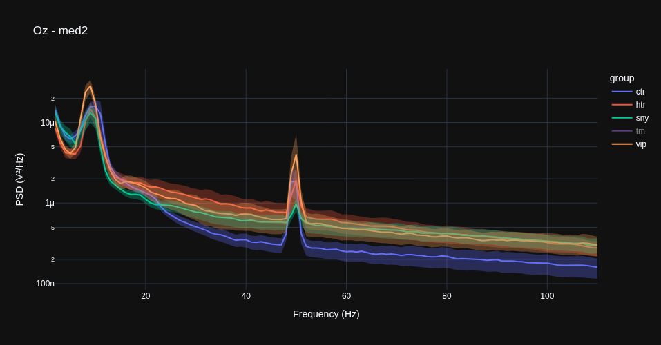
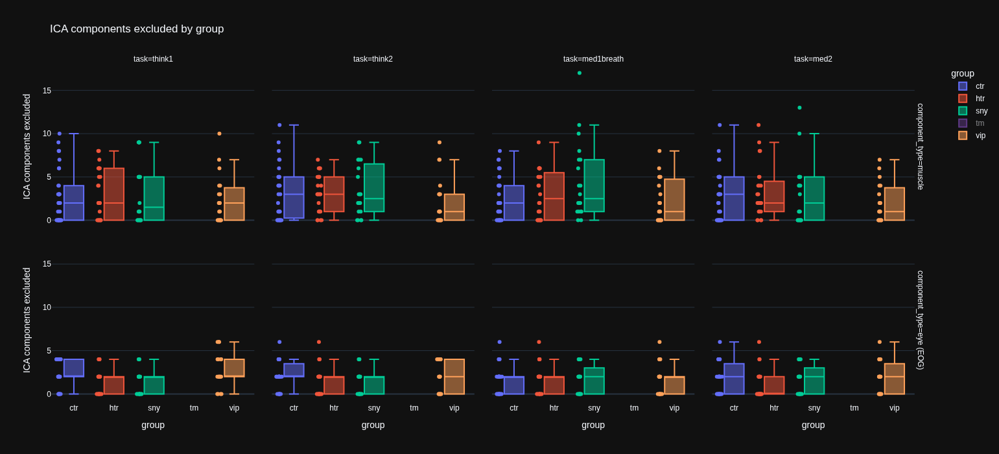
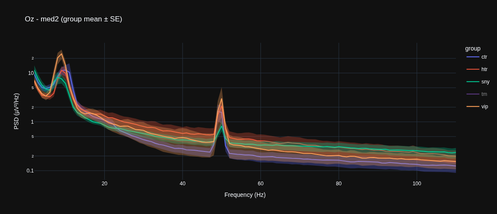
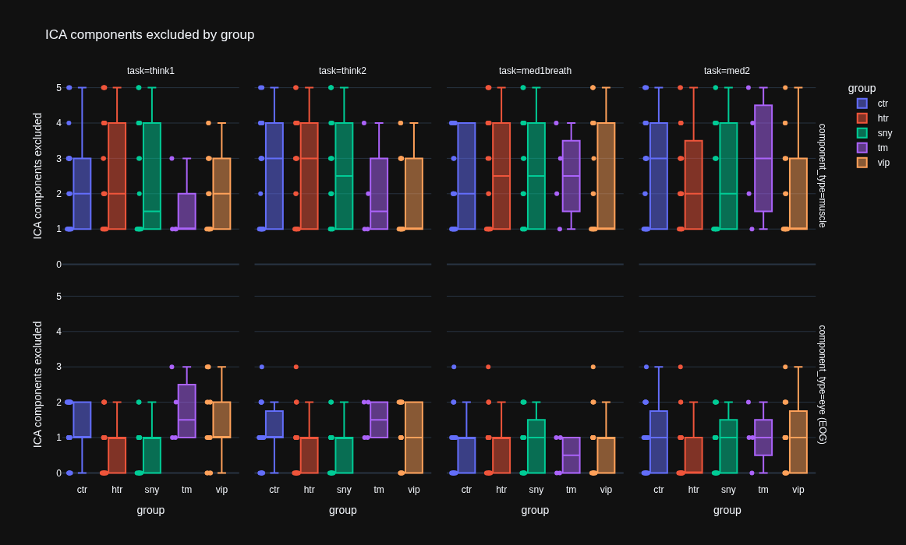

# EEG Replication Project

Aim: build a simple EEG processing pipeline then replicate some basic results from a paper (https://pmc.ncbi.nlm.nih.gov/articles/PMC5261734/)

Data is at: https://openneuro.org/datasets/ds003969/versions/1.0.0

##  Steps

1. Install relevant packages 
2. Explore data in a notebook 
3. Get familiar with analysis tools like MNE-python, MNE-BIDS
4. Produce some standardised analysis and explore data formats
5. Implement independently some analytical functions to produce desired outputs
6. Compare results to package implementations for similarity

## Curiosities for later exploration

* Authors use right mastoid as reference, why not left, do these give similar results?

* Authors don't seem clear on what hypotheses they tested? it's probably worth thinking about how many hypotheses they likely tested to end up with their final results and adjusting things accordingly.

* Authors make some conclusions regarding frequency bands including 100Hz but they don't do much to deal with 50Hz line noise. They exclude this 50Hz band but they don't account for harmonics. Is this an issue? Manual inspections doesn't show much going on at 100Hz that is abnormal.

* The exclusion of two outliers in figure 4D without explanation about how they decided to do that is outrageous given that this choice is clearly entirely responsible for the positive slope they report.  
## Replication summary

* Referenced to right mastoid (EXG6)
* Subsampled to 256Hz
* Bandpass filtered with same filter
* Implented the `pop_rejcont` function in python, manual  inspection of it's flagging seems sensible
* The next step involved manual inspection then rerunning `pop_rejcont` with lower tolerance over certain series. Given they don't specify how they chose these I can't replicate it and shall hope it's unimportant.


### 30/9/26

I've manage to figure out how to load data in this standardised format using `mne-bids`, then had a play around with analysing it using `mne`.

The data is quite simple to use but I'm running into some annoying OOM issues as well as having too slow internet.

Next steps are to get more familiar with `mne` and what it can do, then try to step-by-step replicate the authors' pipeline. Initially let's try do this exactly whilst commenting on anything that seems off, we can revisit robustness to those later.

A useful note on the electrodes from the data website:

```Hello, Here are the details of the positions of the external electrodes:
Ext1 --> left eye corner
Ext 2 --> right eye corner
Ext 3 --> left eye eyebrow (above)
Ext 4 --> left eye below
Ext 7 --> middle of the collar bone
Ext 5 --> left mastoide
Ext 6 --> right mastoide
EXT 8 was set up with an extra electrode for Fp1, due to a defect of that electrode on the Biosemi electrode set.
So from that you have: 
 Ext1 and Ext2: HEOG; 
 Ext3 and Ext 4: VEOG (blinks); 
Ext 7: ECG
Ext5: M1
Ext6: M2
Ext8: FP1

Hope it helps!
```

Right mastoid is used for reference by authors. Setting this removes most of the obvious line artifacts.

Implementing pop_rejcont in python involved getting very much into the weeds. Lots of details left out of the paper and needed to be guessed at from the matlab defaults, claude handled implementation and wrote tests.

Have made it up to manual bad channel inspection, I have a plan for this tomorrow.

### 1/10/26

Day two and I'll start properly later but a nice side quest has presented itself.

I want ideally a pipeline I fully understand and trust, that I can point at new data sources and be happy with with little manual work. Hence, I want to automate my bad channel detection. So plan is to build a simple bad channel detection widget, run this, then still do the full manual detection to confirm it's working after. I had the idea in my mind to look for some sauna EEG data and it would be nice to just run and verify rather than implement fresh each time. Given all this it's worth pulling all this out into my own convenience package in the future.

I've added a simple minimum variance threshold in the automated pipeline now, things are running well.

Next steps:

* Make notebook for going through manual annotation
* Come up with a format for storing processed data and record of bad channels
* Figure out what's going on with referencing interacting badly with `pop_rejcont` and filtering


Everything looks fine with referencing, it's doing the simple subtraction transform one expects.

Looking more closeltt at the data it's clear that referencing messes up the broken channels, with the broken channels just becoming the inverse of the reference channel, then looking like normal data later on once processed. We definitely need to identify bad channels by processing but not referencing then inspecting.

Still need to play around with this more.

### 2/10/26

Planned pipeline:

* Preprocess without referencing to identify bad channels
* Save bad channels
* Do preprocessing with referencing
* Then, infomax ICA on processed data
* Save processsed data
 
for the ICA part they reference this paper https://pubmed.ncbi.nlm.nih.gov/17188898/

It seems they use an automated implementation in Matlab. MNE/python also has this functionality and I'll try to use something similar.

I also stumbled upon the `autoreject` package for bad channel/epoch detection, worth looking at this in more detail for the future rather than redoing the janky stuff in this paper.

I figured out why Fp1 is bad: it isn't used and EXG8 is used instead, just need to swap the data in there. This makes things look more sane. pop_rejcont seems to be working as intendd.

OK so new plan now that referencing and other problems resolved:

* Do preprocessing
* Suggest bad channels, visually inspect to confirm
* Do ICA
* Save all processed data 

For now I have the bad channel suggestion automated using the built in `mne` function based on waveform distance, but also I built my own that takes that approach but applies it to spectral distance over 1-45Hz. These seem complementary and so far the suggestions seem good. I'll run through a bunch before the final run through to calibrate the thresholf I want to use here.

Now I need to look into ICA. The authors are not overly specific so it sound like they use a vanilla package version. I shall do similarly, using the python version but making the settings close where possible.

It seems there is quite an art to detecting ICA components. https://labeling.ucsd.edu/tutorial/labels is a very good resource for this. I'm not quite confident yet to go through each manually and call out which they are. Luckily MNE has automatic detection functions in place for muscle and EOG artefacts which seem to behave sensibly on some test cases. I'm going to just use these.

### 3/10/26

Yesterday I implemented the ICA stuff. As in the work we're replicating, we'll try to exclude muscle and eye artifacts from the data. There are automated functions for this in MNE, and I've used those. Looking at the outputs of those in a notebook and comparing to the resource above all the suggestions seem sensible.

The full data processing loop is now ready to go. I'm going to run it with the manual bad channel labelling for now, see how much my selections agree with the automated suggestions. If they line up nicely then I'll just run the whole thing automatically, perhaps changing the thresholding slightly on the automated functions to line them up better.

OK I'm going to run this automated and then compare results/see how many channels are marked bad, as decisions seem good so far. 

TODO: compare decisions with my simple criteria here to RANSAC

Have looked at using autoreject and it does seem to be making sensible decisions, but it deviates too much from the original paper so I will make a note to use it in the future but not for this initial replication attempt.

Everything has run now and I'm processing the data to take a quick look at how close we get to replicating the headline result from previously.

### 4/10/26

Below is the first pass at replicating the power spectra by group. We see the vipassana group having higher alpha band power, and this is common across conditions as in the paper, looking like a fairly robust result. 

However, the gamma band trait difference observed by the authors between the control group and the rest is not observed at all. This is famously difficult this region due to muscle and eye artifacts. Given how the authors identify the ICA components for these things very manually, it's quite hard to tell why my results differ so dramatically.

dsa

dsa


Next steps are to investigate this alpha discrepancy. The effects is so marked in the chart above but is not present at all in my data.

It is likely due to a difference in processing pipelines, and most likely how muscle ICA components are removed. I'll revisit that and see how decisions were made for each group.

First I've looked at individual traces all on the same plot grouped by type. There are no clear outliers here


This is at least guidance that whatever the difference is, it is likely systematic rather than outlier handling.

Another questions I need to get on top of is translatin my graphs to the same weird y scale they use: I want to know where the power differences are more severe in the spectrum.

At least my values agree with normal values across studies, so I'm not wrong I just need to get the conversion right.

There values are not plausible so there is a factor that is off here. It looks like it's from squaring the FFT but not normalising. Normalisation factor is maybe 48dB, which aligned things roughly with my results (back of the envelope).

I also made a plot to visualise how many ICA components were removed by group/task/ICA type and things look pretty consistent across mine: 


I've been removing a lot more artifacts than the original paper:

*"For each subject, we visually
identified and subtracted one to five well-characterized ICA components from the data."*

I'm way above 10 in many cases!

Which is actually a bit insane given that I only estimated 20 components in each case. Maybe I'm being really aggressive here and removing way too much high frequency stuff. 


It would be interesting to rerun the analysis with the muscle artifact stuff toned down or removed.

Hypothesis: author effect is real, my aggressive ICA component removal is flattening power at higher frequencies, removing any evidence of the effect.

Tests:

* Rerun without ICA removal
* Rerun with better scoped/limited ICA removal, perhaps adjusting thresholds so that we get 1-5 components removed typically, and cap at removing 5.

Here's  the same but for the number of bad channels removed by task and group.


So on average around 7-8 channels are removed, and this varies a bit by group.

From the paper:

*"We then manually identified and removed bad electrodes (from 0 to 18 bad electrodes per subject, average of 5 electrodes removed per subject)."*

So not too far off here, or at least closer than for the ICA. Still siding on harsher than the paper authors.

### 5/10/23

I'm now rerunning my pipeline but with relaxed ICA thresholds (suffix `_v2`). I'll replicate the previous analysis and see whether anything looks different in the gamma bands.

Whilst that is running I've closed VSCODE to stop things exploding, it's memory overhead is massive and I'm only working with 8GB here. Can't wait to upgrade to 32...

Let's plan whilst we wait for it to run:
	1. Check results of latest run, see whether gamma results change, figure out if there are any obvious next steps to solve this mystery, bearing in mind the eventual write-up.
	2. Do a little bit more analysis just plotting within group across task comparisons. Simple lines of differences in spectral power within each group across task settings with a simple se window. 
	3. Next phase: other calculations: LRTCs and fEI. I find the criticality measures and papers really interesting so let's implement those functions manually to improve understanding of all the steps in the process. Then once it's implemented manually we can compare to an existing implementation for a double check.
	4. Once we have some criticality measures implemented, let's look at these for each of the groups, comparing meditation to thinking. I'll need to form some hypotheses. 1: alpha and beta LRTCs increases under meditation for the meditator groups. Perhaps it does also for the controls, but I would expect a lesser impact. 2: alpha and beta LRTCs in meditators decrease as meditation continues as there is increased meditative depth. This can be done simply comparing the means of the first and second periods. 3. In resting/non-meditative state there is no significant difference in alpha/beta LRTCs. 

Here's the updated headline plot with more relaxed muscle artifact detection:



This looks much more like the authors' headline plot. Changes here were increasing the muscle artifact detection threshold from 0.5 to 1 and changing the EOG artifact detection from 3 to 5.

Uh oh! Looking at the logs there were actually zero muscle and eog artifacts removed! That seems like too much. Time to rerun with some settings in the middle. That's what I get for changing a threshold without fulling understanding it or testing its effects.

I've now defaulted the EOG thresholding to what it was before as things didn't seem crazy there, and changed the muscle threshold to 0.75. Running now as v3.

### 6/10/26

The v3 run has more sensible numbers of ICA muscle components removed:



However, this is still not ideal. Whilst medians are sensible around 2, we have lots of outliers and lots of cases where 0 outliers are removed. The headline gamma result is also missing under this specification.

Idea: new specification where we bound the number of components removed. 

Weirdly I've observed only even numbers of EOG ICA components being removed, what's going on? This is an artifact of weird passing of e.g.  `np.int64(2)`, the numbers chosen are sensible ints. No concerns there.

V4 is running now with the same thresholds but muscle ICA components limited to be at least 1 and EOG components limited to 4 or less. Total components is bounded at 5 with EOG taking precedence. This should be somewhat close to the authors. If  this doesn't move us towards observing the gamma difference we saw with no ICA components removed then I would suspect the EOG components more likely to be causing the differences. The constraints here should only really be binding for muscle components.

Here's the latest from v4:



So this looks a bit closer to the authors. We still get the significant alpha differences and lower gamma for control but it's not really significant here. The only major change here is restricting how many muscle artifacts get removed, capping them at 5 effectively. The box plots for components removed look as intended/expected:



Overall we're closer but this doesn't feel completely satisfying. I could be chasing my tail on this indefinitely given there's no way to match the authors' original choices. The next step would be to upskill at the manual inspection, read some guidance in various places, then do this in full with the bad channels too. This would however be fairly time intensive and for now isn't the best learning opportunity, so I'll put a pin and maybe come back to it only if I have other analysis to do on this data and feel that trusting the data more would help me trust some other more interesting conclusions.

So next:
	2. Do a little bit more analysis just plotting within group across task comparisons. Simple lines of differences in spectral power within each group across task settings with a simple se window. (Claude can do this)
	3. Next phase: other calculations: LRTCs and fEI. I find the criticality measures and papers really interesting so let's implement those functions manually to improve understanding of all the steps in the process. Then once it's implemented manually we can compare to an existing implementation for a double check.	
	4. Once we have some criticality measures implemented, let's look at these for each of the groups, comparing meditation to thinking. I'll need to form some hypotheses. 1: alpha and beta LRTCs increases under meditation for the meditator groups. Perhaps it does also for the controls, but I would expect a lesser impact. 2: alpha and beta LRTCs in meditators decrease as meditation continues as there is increased meditative depth. 3. In resting/non-meditative state there is no significant difference in alpha/beta LRTCs. 

OK I've generated plots now looking at the differences within groups across tasks, and across groups within tasks. When I plot the z-scores for the differences nothing that crazy pops out. I reran this for v2/v3 too. It was a good exercises in getting Claude to do all of my charting but no major results. I also don't want to look into it in too much detail whilst I don't trust the data processing pipeline fully. 

Next step is continuing manual implementation of criticality measures. I actually don't need to vectorize this properly, just get it matching `crosci` for a single channel as it is a test of my understanding of the process, not my ability to write it in parallel form...

### 7/10/26

I've implemented simple versions of DFA and fEI and checked against `crosci`, values differ slightly as windowing is not identical, I think due to the windowing being a little different. I have however understood what's going on under the hood better, so mission achieved there.

I've now got the whole pipeline running end to end and fairly fast. I've got a notebook going and have inspected the data and run some simple little regressions to test whether there are any clear effects. The only thing that stands out in my initial pass was some evidence for higher criticality in `med2` than any of the other tasks, with no significant differences between the others. This was for DFA, and the fEI stuff looks like a wash.

Tomorrow I'll do some more formal analysis, along the lines of testing the hypotheses above.

### 8/10/26

Formal experiments: 

	* Is DFA criticality higher for meditators when meditating?
		* Aggregating the meditation conditions we don't see this, insignificant effect 	
		* Splitting them out, nothing is significant for alpha, but for beta we get med2 having 0.05 higher DFA than the rest, significant at 0.022 p-value. This is some gentle evidence for the second hypothesis.
		* Given this effect is present for beta but not alpha, I've looked at the rest of the bands to see if they support this being real. Delta shows nothing, theta nothing, alpha nothing, beta something, broadband similar effect but a z-score of only 1.955, which after some currently missing corrections is sure to be nothing.
	* Resting state DFA is not siginificantly different for meditators and controls.
		* This holds for all bands, power is not always amazing but we could reject hypotheses of 10% plus differences uniformly.

That was all pretty quick and easy, but the question hanging over this all is how much I trust the data processing pipeline...

I don't really want to write this up without trusting the pipeline, so I think I do need to manually check the pipeline. First step is to optimise the setup for doing this.

With the setup optimised I've started running through this. I've got through 8 subjects and it's pretty slow going. As I go I feel less certain about my choices. There are some ICA components that look pretty crazy but not in a way that makes them clearly muscle or eog components. One thing I have noticed is that the picks for muscle components are actually pretty sensible but the picks for eog components are not that great and often need correcting. Maybe a quicker and easier option would be to try and improve the automated eog detection and see if that changes results. 

This would fit with my previous observation that the authors' results came back when all ICA components were included, but did not come back in a significant way when I adjusted how the muscle artifacts were found.

I've just noticed that the channels I was using for EOG detection, as the auxiliary channels, were not being filtered before the EOG detection was done. This seems like a gotcha. Running v2 now with the same prefiltering applied to those channels as everything else.

Ah nevermind it was being filtered within the find bad function...

Find a minor gotcha in that bad channels weren't being excluded before ICA... rerunning v2 now with that as the diff to check if it is significant. Things are makes now. (This makes little difference, is the v3 result here).

v4 running with higher threshold for EOG, should test directly the hypothesis that differences in results from the authors are due to this component.

What's next? I've got some results, maybe I'll do a bit more data cleaning, we shall see. Eventually I will write this up in a condensed form. It need not be a polished paper.

### 16/10/26

Back looking at this after a week at MoC. Getting Claude to autowrite the report was a good exercise, as it uncovered some issues and gave a nice framing for the writeup.

Next steps:

* Rerun matching the sample from the original paper. I'd overlooked they did a sample matching strategy. This is now rerunning and regenerating everything with run suffix `_matchsample_v0`
* Afterwards I need to run a `_matchsample_noica_v0` version and compare the results and see if all the headline stuff holds.